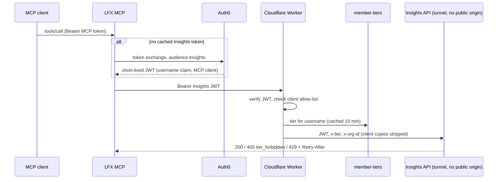

# ADR-0027: The LFX MCP calls the Insights API with an Auth0 token exchange

**Date**: 2026-11-12
**Status**: accepted
**Deciders**: Insights team, LFX architecture (Eric Searcy), LFX MCP (Pepe Reyero), SSO (Robert Detjens)

## Context

The LFX MCP server (`mcp.lfx.dev`) will expose the Insights Public API as MCP tools. A request that starts in an MCP client must still reach the API as the user, so that the API can apply the user's tier and per-LFID rate limit ([ADR-0023](./0023-basic-and-premium-tiers.md)). Today the Cloudflare Worker in front of the API only accepts `lfi_` PATs. It exchanges them at Auth0 ([ADR-0006](./0006-pat-token-exchange-for-api-credentials.md)), resolves the user's tier, and forwards `x-tier` and `x-org-id` to the API through a Workers VPC binding and a Cloudflare tunnel. The API has no public origin. It trusts those headers because the Worker is the only way in. lfx-mcp already reaches the LFX Self Service APIs with an RFC 8693 token exchange. The resulting design is in [`docs/design/insights-mcp-integration.md`](../../../../docs/design/insights-mcp-integration.md).

## Decision

We will have the MCP exchange the signed-in user's MCP token at Auth0 (RFC 8693, through the MCP's Custom Token Exchange profile) for a short-lived token with the Insights API audience, and call the API through the existing Worker. The Worker gains a JWT path next to the `lfi_` PAT path:

- It verifies the token against Auth0's public keys (issuer, Insights audience, RS256, expiry).
- It checks the client claim against an allow-list that holds only the MCP.
- It reads the username and resolves the tier with the existing member-tiers lookup and cache.
- It forwards `x-tier` and `x-org-id` exactly as it does for PATs.

The API itself doesn't change. Limits, tiers and endpoint gating stay in the API, and a user's MCP and PAT traffic share one per-LFID budget.

The MCP turns API errors into tool errors and never retries in a loop:

| API response         | Tool error                                                             |
| -------------------- | ---------------------------------------------------------------------- |
| `401`                | Unauthorized                                                           |
| `403 tier_forbidden` | Needs an LFX membership (premium)                                      |
| `404`                | Not found                                                              |
| `429`                | The limit was hit; wait `Retry-After` seconds and avoid parallel calls |
| `5xx`                | Insights is temporarily unavailable                                    |

Callers without a user (M2M tokens, static API keys, stdio mode) get no Insights tools in v1.

## Alternatives Considered

### Alternative 1: The MCP creates and stores one Insights PAT per user

- **Pros**: Uses the existing PAT path with no Insights change. A user could revoke the MCP's access to Insights, and only that, from Developer Settings.
- **Cons**: The MCP becomes a store of long-lived user secrets, which needs new shared encrypted storage. It has to manage the PAT lifecycle: create, rotate, detect revocation, recover stranded tokens. It also needs PAT service changes for token state, token type and revocation by LFX.
- **Why not**: Far more moving parts for a benefit that is smaller than it looked. With a token exchange, no long-lived credential exists to leak or rotate. MCP clients hold refresh tokens with rotation. If Insights ever needs to block one user on its own, a deny-list by LFID or token id can be added to the Worker or the API. Neither exists today, and it isn't part of this decision.

### Alternative 2: The MCP calls the API directly and sets the tier headers itself

- **Pros**: One hop fewer. The Worker keeps a PAT-only role.
- **Cons**: Needs a second network path into the API next to the tunnel, and the API would have to accept `x-tier`/`x-org-id` from a second caller. The MCP would also repeat the Worker's tier lookup.
- **Why not**: It widens the API's trust model. The Worker path needs no network change and reuses the tier logic that already runs.

### Alternative 3: Forward the user's MCP token to the API as is

- **Why not**: Token passthrough, which the MCP authorization spec forbids. The API would accept tokens minted for another service.

### Alternative 4: An MCP machine token plus a user header

- **Why not**: The user's identity would rest on the MCP's word, on a path that gates premium endpoints.

### Alternative 5: Users paste their own PAT into the MCP

- **Why not**: A second secret to manage. It bypasses the OAuth sign-in, and many MCP clients don't support custom headers.

## Consequences

### Positive

- Signing in to the MCP is enough. There's no credential to create or paste, and no secret at rest in the MCP.
- One implementation of limits, tiers and gating, already in production.
- It follows the pattern lfx-mcp already uses for other LFX services.

### Negative

- Insights access through the MCP can't be revoked on its own. The levers are removing the user's MCP access or blocking the LFID in Auth0, and both only stop new sign-ins. The API has no deny-list, so tokens already issued keep working until they expire: the remaining lifetime of the user's MCP token plus that of the last Insights token. If the token exchange rechecks MCP access (an open question for SSO), the window shrinks to one Insights token lifetime.
- New Auth0 configuration for a second exchange audience.

### Ownership

- **Insights team**: the Worker's JWT path and client allow-list, documentation, and the Insights API changes in [ADR-0028](./0028-insights-data-in-the-lfx-mcp.md).
- **LFX MCP (Pepe Reyero)**: the token exchange, the Insights tools (`explore_lfx_insights`, built from the OpenAPI spec, and `query_lfx_insights`), error mapping, routing guidance and rollout. The tools call `/v1-alpha` until `/v1` ships ([ADR-0021](./0021-rfc-deprecation-sunset-header-formats.md)).
- **SSO (Robert Detjens) and Insights team**: the Auth0 exchange profile and claims for the Insights audience. Can the existing exchange profile target the Insights audience? Does it carry the username claim? What token lifetime? Which claim identifies the client (`azp` or `client_id`)? Can the exchange recheck MCP access?

### Follow-ups, not blocking the integration

- The Cloudflare side of the API path is configured in the dashboard of the _Linux Foundation - LFIT Managed_ account: the tunnel, the Workers VPC service, the Worker's domain and the cache rules. The `cloudflared` deployment is in crowd-kube and the Worker in this repository. The dashboard settings should move into IaC. `lfx-cloudflare-terraform` covers the _LFX Products_ account, so where that IaC lives is still to be decided.
- The Worker's domain should move into `wrangler.jsonc`. The Worker itself is already deployed by `.github/workflows/public-api-deploy.yaml`, with a smoke check.
- The other diagrams of the API path (`docs/design/caching.md`, the ASCII diagram in `PUBLIC_API_PLAN.md`) should show the tunnel, the Workers VPC binding and the API's network boundary, as the integration design does.
