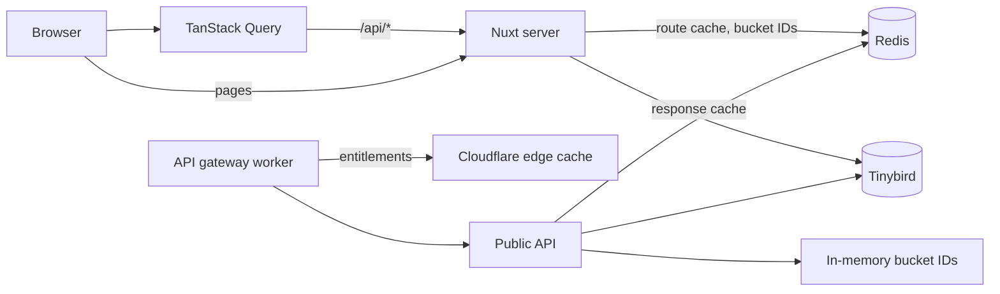
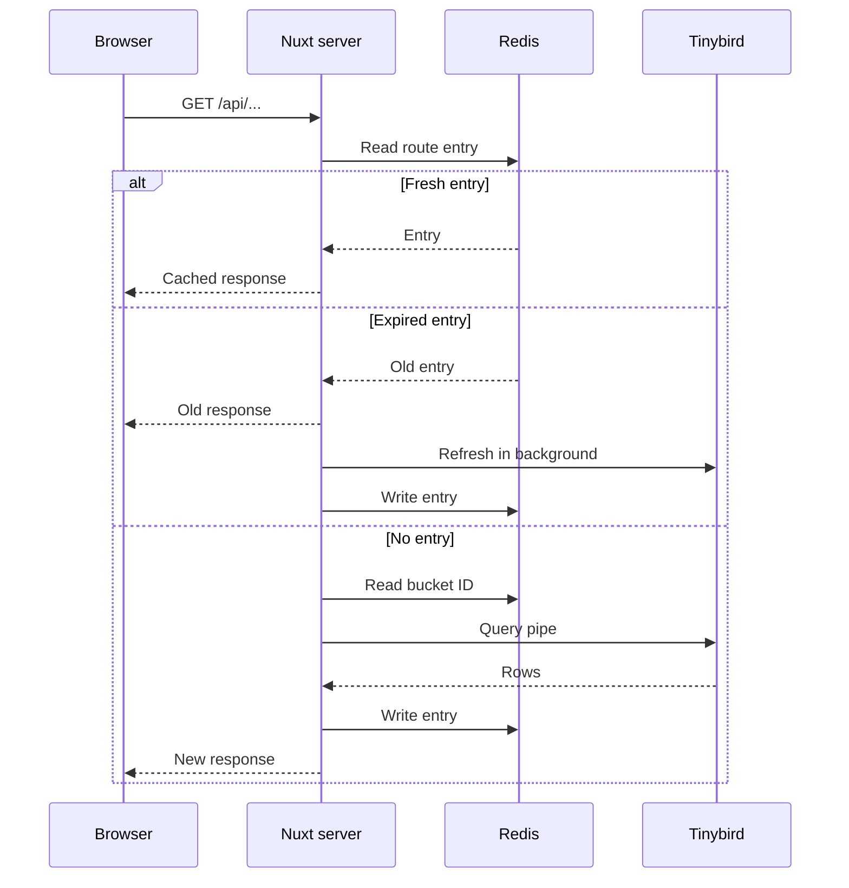
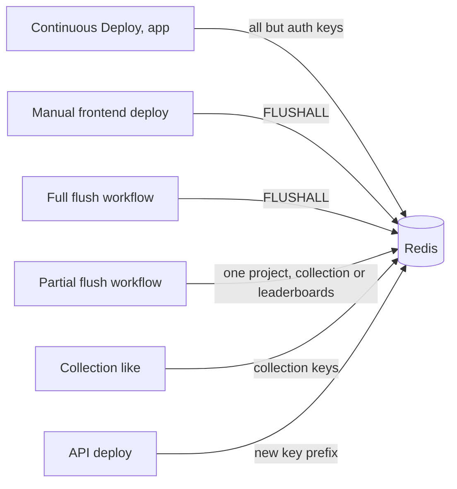

# Caching layers

How the caches in front of Tinybird connect across the site, the public API and the deploy
workflows. Route rules, keys and TTLs are listed in
[`docs/knowledge/flow-caching.md`](../knowledge/flow-caching.md); this page shows the shape.

## Component map

The public API caches in the Redis named by `API_REDIS_URL`, which `response-cache.ts` treats as
shared with the site; its keys carry their own prefix. The API gateway's edge cache holds who the
caller is, not response data.

## Request flow through the site

A cached route on the Nuxt server. Routes without a Redis rule skip the cache step and always call
Tinybird.

Every cached response carries `max-age` set to the rule's TTL, so the browser may answer the next
request itself.

The public API follows the same read, miss and write steps with a fixed TTL and no background
refresh, and it answers with `private, max-age=0`.

## Invalidation flow

No signal reaches Insights when Tinybird data changes, so caches clear only by TTL or by these
triggers.

The flush steps are in the
[Production Cache Flush](../../.github/workflows/production-cache-flush.yaml) and
[Production Cache Flush (Partial)](../../.github/workflows/production-cache-flush-partial.yaml)
workflows.
