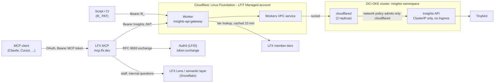
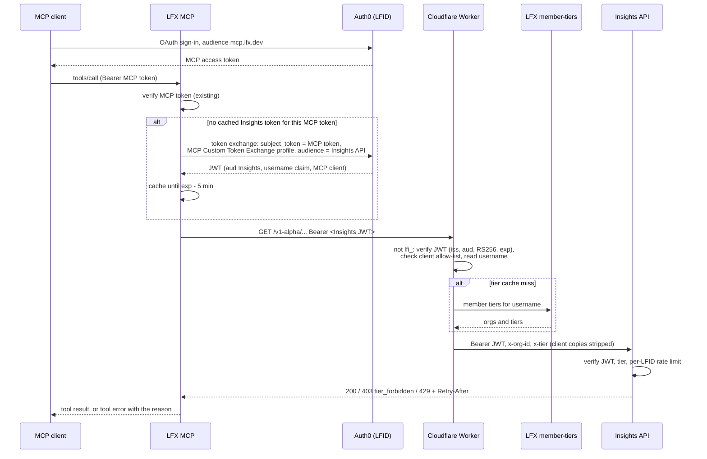

# Insights Public API in the LFX MCP

> **Planned.** This describes the design accepted in
> [ADR-0027](../../api/docs/arch/adr/0027-mcp-calls-insights-api-with-token-exchange.md) (authentication)
> and [ADR-0028](../../api/docs/arch/adr/0028-insights-data-in-the-lfx-mcp.md) (which source answers what).
> Parts of it are already live: the Worker, the tunnel and the PAT path. The rest becomes current state as
> the work ships. Update this doc in the same pull requests.

The LFX MCP server (`mcp.lfx.dev`) exposes the Insights Public API as MCP tools. An MCP user's Insights
calls are identified, tiered and rate-limited exactly as if the same user called the API with a PAT.

## Components

- The API has no public origin. The only way in is the Worker, through a Workers VPC binding and a Cloudflare
  tunnel to the `cloudflared` pods. That is why the API can trust the `x-tier` and `x-org-id` headers the
  Worker sets.
- The `cloudflared` deployment, the API Service and the network policies are in crowd-kube
  (`lf-insights-production/k8s/`). The Worker is in `workers/api-gateway/`. The Cloudflare-side settings
  (tunnel, Workers VPC service, Worker domain, cache rules) are configured in the Cloudflare dashboard. Moving
  them into IaC is a follow-up (ADR-0027).

## Request path

| Component    | Role                                                                                                                                                                                                                                                                                                                       |
| ------------ | -------------------------------------------------------------------------------------------------------------------------------------------------------------------------------------------------------------------------------------------------------------------------------------------------------------------------- |
| LFX MCP      | Exchanges the user's MCP token for an Insights-audience token and caches it in memory. Never forwards the MCP token itself.                                                                                                                                                                                                |
| Auth0        | Issues the Insights-audience token through the MCP's Custom Token Exchange profile, with the username claim.                                                                                                                                                                                                               |
| Worker       | Two paths: `lfi_` PATs (existing) and Auth0 JWTs from allow-listed clients (the MCP). Both resolve the tier the same way and set `x-tier` / `x-org-id`. It verifies the JWT before any tier lookup, so unsigned input never drives a lookup or a tier decision.                                                            |
| Insights API | Unchanged. It verifies the JWT with Auth0's public keys, applies the tier (`403 tier_forbidden` on organization endpoints for basic) and the per-LFID limit for that tier (`RATE_LIMITS` in `api/src/rate-limit.ts`, currently 5 requests per second for basic and 100 for premium, also returned in `X-RateLimit-Limit`). |

A user's MCP traffic and PAT traffic share one rate-limit budget, because the limit is per LFID.

## Errors

The MCP returns errors as tool results (`IsError: true`) and never retries in a loop. Pods are stateless,
and a sleeping request ties one up for nothing.

| Insights response         | Tool error                                                                      |
| ------------------------- | ------------------------------------------------------------------------------- |
| `401`                     | Unauthorized. Logged; no retry.                                                 |
| `403 tier_forbidden`      | This data needs an LFX membership (premium tier), with a link to the tier docs. |
| `404 not_found`           | Not found, with the API's message (and candidate matches once they ship).       |
| `429 rate_limit_exceeded` | The limit was hit. Wait `Retry-After` seconds and avoid parallel calls.         |
| `5xx`                     | Insights is temporarily unavailable.                                            |

## Callers without a user

M2M tokens, static API keys and stdio mode carry no user, so they get no Insights tools in v1. If a real need
appears, the caller uses its own `lfi_` PAT against the API directly.

## Tools and data routing

The MCP exposes Insights through two tools: `explore_lfx_insights`, which finds projects, collections and
endpoints from the OpenAPI spec, and `query_lfx_insights`, which runs one endpoint. They call `/v1-alpha`
until `/v1` ships.

| Question                                                                                | Answered by           |
| --------------------------------------------------------------------------------------- | --------------------- |
| Foundations, the LF hierarchy, Salesforce, CRM accounts, marketing                      | Snowflake (LFX Lens)  |
| Collections, Insights metrics (such as the health score), projects as shown in Insights | Insights              |
| Data both have, when Snowflake can't answer                                             | Insights, as fallback |
| Users who aren't LF staff                                                               | Insights only         |

Where both serve the same data, Tinybird and dbt apply the same business rules
([ADR-0028](../../api/docs/arch/adr/0028-insights-data-in-the-lfx-mcp.md)). The API adds:

- `GET /projects` with LFX identifiers, so the MCP can resolve a project
- an `applied` block on widget responses, so answers state their scope, window and filters
- `404` with candidate matches for unknown slugs
- later, a daily health snapshot

## Ownership

| Area                                                                                 | Owner                            |
| ------------------------------------------------------------------------------------ | -------------------------------- |
| Worker JWT path and allow-list, API changes, Insights docs, Tinybird-side rule fixes | Insights team                    |
| Token exchange, Insights tools, error mapping, routing guidance, rollout in the MCP  | LFX MCP team                     |
| Auth0 exchange profile and claims for the Insights audience                          | SSO and Insights team            |
| Shared business rules between Tinybird and Snowflake                                 | Insights team and data lake team |

## Rollout

1. **Auth0**: the MCP's exchange profile can issue Insights-audience tokens with the username claim. Token
   lifetime set. Tested in the dev tenant first.
2. **Worker**: the JWT path, off by default until the MCP client is on the allow-list.
3. **MCP**: the Insights tools, off by default, using the token exchange and the error mapping above.
4. **Data rules**: the rules ADR-0028 lists as required before launch match in Tinybird and Snowflake, and a
   parity audit confirms it.
5. **End to end in dev**, then the MCP client is allowed in the production Worker and the tools are turned on
   for every LFID.
6. **Docs**: the Insights API docs (MCP access shares the per-user limit), the MCP README, and lfx-mcp's
   `docs/community-access.md` (community accounts can now reach Insights data).
