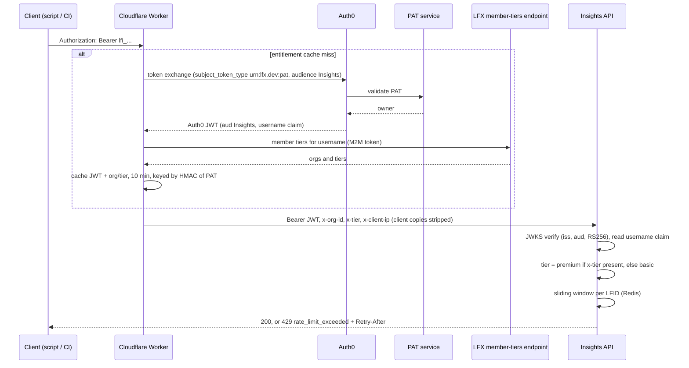
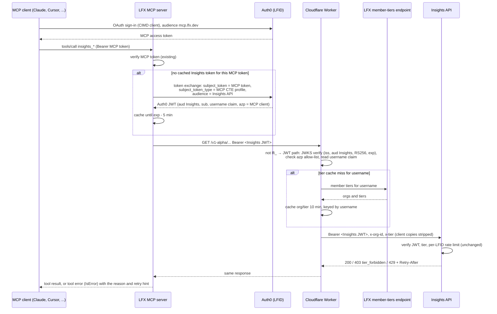
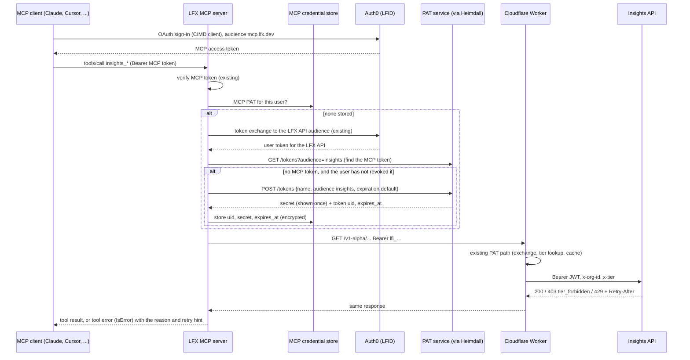

# Insights Public API in the LFX MCP: authentication and rate limiting

**Status**: proposal, for review
**Date**: 2026-10-28, updated 2026-10-30
**Author**: Joana Maia
**Related**: [ADR-0006](../../api/docs/arch/adr/0006-pat-token-exchange-for-api-credentials.md), [ADR-0010](../../api/docs/arch/adr/0010-billing-bundled-with-lfx-membership.md), [ADR-0015](../../api/docs/arch/adr/0015-api-keys-issued-by-lfx-self-serve.md), [ADR-0020](../../api/docs/arch/adr/0020-standalone-pat-service-on-platform-cluster.md), [ADR-0023](../../api/docs/arch/adr/0023-basic-and-premium-tiers.md), [linuxfoundation/lfx-mcp](https://github.com/linuxfoundation/lfx-mcp) (`ARCHITECTURE.md`), [linuxfoundation/lfx-v2-pat-service](https://github.com/linuxfoundation/lfx-v2-pat-service)

## 1. Summary

The LFX MCP server (`mcp.lfx.dev`) will expose Insights Public API endpoints as MCP tools. The open question is authentication: how a request that starts in an MCP client reaches the Insights API so that the API can still identify the user, apply the user's tier (basic or premium) and enforce the user's rate limit.

Both options in this document share the same foundation:

- **Rate limits stay in the Insights API.** The MCP does not enforce Insights limits. It passes the authenticated user to Insights and turns the Insights `429` into a clear tool error.
- **The user signs in to the MCP as today** (OAuth with their LFID). No extra step, no secret to copy.
- **The Insights API does not change.** It keeps verifying an Auth0 JWT with the Insights audience and keying the rate limit by the LFID. A user's MCP traffic and PAT traffic share one budget.

They differ in the credential the MCP uses to call Insights for the user:

| Option                 | In one line                                                                                                                                                                                                                                                                       |
| ---------------------- | --------------------------------------------------------------------------------------------------------------------------------------------------------------------------------------------------------------------------------------------------------------------------------- |
| **1. Token exchange**  | The MCP exchanges the user's MCP token at Auth0 (RFC 8693) for a short-lived token with the Insights audience, the pattern lfx-mcp already uses for the LFX Self Service APIs. The Cloudflare Worker gains a JWT path next to the `lfi_` PAT path.                                |
| **2. MCP-managed PAT** | The MCP uses the user's login to create, through the PAT service, one MCP-specific `lfi_` PAT per user, stores it, and calls Insights through the existing PAT path. It rotates the PAT when it expires and stops when the user revokes it. Nothing changes on the Insights side. |

Option 2 is closer to the strategy the Public API was designed around: long-lived PATs issued by the PAT service as the single credential, which [ADR-0006](../../api/docs/arch/adr/0006-pat-token-exchange-for-api-credentials.md) expected to be "directly usable as MCP client credentials". Option 1 is closer to how lfx-mcp already reaches other LFX services. Section 5 compares them.

**Revocation is the main trade-off.** With option 2, a user's access to the Insights API through the MCP is one PAT: revoking it cuts Insights access, and only Insights access, within minutes, and the user can see and revoke it in Developer Settings. With option 1 there is no credential to revoke. A user's Insights access cannot be revoked on its own: the only levers are removing the user's access to the whole MCP or blocking their LFID, and even then tokens already issued keep working until they expire (section 9).

## 2. Current state

### 2.1 Insights Public API

Facts this design relies on (all from the current code):

| Component | Behavior                                                                                                                                           | Where                                            |
| --------- | -------------------------------------------------------------------------------------------------------------------------------------------------- | ------------------------------------------------ |
| Worker    | Accepts only `Bearer lfi_...`. Any other token gets `401` before reaching the API.                                                                 | `workers/api-gateway/src/pat.ts`, `src/index.ts` |
| Worker    | Resolves org and tier from `b2b_orgs/member-tiers/{username}` (or the LaunchDarkly admin list), caches the result with the JWT for 10 minutes.     | `src/tiers.ts`, `src/flags.ts`, `src/cache.ts`   |
| Worker    | Always strips client-supplied `x-tier`, `x-org-id`, `x-client-ip`. Reaches the API through a Workers VPC binding, so the origin is not public.     | `src/headers.ts`, `src/origin.ts`                |
| API       | Verifies the JWT with Auth0 JWKS: configured issuer, configured Insights audience, RS256. Rejects a token without the username claim.              | `api/src/auth.ts`                                |
| API       | Any `x-tier` value means premium, none means basic. Organization endpoints are premium only (`403 tier_forbidden`).                                | `api/src/tier.ts`                                |
| API       | 30 requests per second per LFID for both tiers for now. Returns `429` with `code: rate_limit_exceeded`, `Retry-After` and `X-RateLimit-*` headers. | `api/src/rate-limit.ts`, `api/src/lib/errors.ts` |

Note: the Insights-audience PAT prefix is `lfi_` (not `lfx_pat_`). This document uses `lfi_` throughout.

### 2.2 LFX MCP server

| Topic                          | Today                                                                                                                                                                                                                                                                                                                                                                         |
| ------------------------------ | ----------------------------------------------------------------------------------------------------------------------------------------------------------------------------------------------------------------------------------------------------------------------------------------------------------------------------------------------------------------------------- |
| Stack                          | Go, official MCP Go SDK, Streamable HTTP (stateless, new server per request) at `https://mcp.lfx.dev/mcp`, plus stdio for local use. Kubernetes, stateless pods with per-pod in-memory caches. No shared storage.                                                                                                                                                             |
| Inbound auth                   | OAuth bearer tokens from Auth0 (LFID, `https://sso.linuxfoundation.org/`). Audience is the MCP public URL. Protected resource metadata (RFC 9728) is published. Clients register through CIMD (no DCR), with static Auth0 clients for MCP clients that lack CIMD. Scopes: `read:all`, `manage:all`. M2M callers (client credentials) and static API keys are also accepted.   |
| Calls to LFX Self Service APIs | RFC 8693 token exchange at Auth0: the user's MCP token is the `subject_token`, `subject_token_type` is the MCP's Custom Token Exchange profile, `audience` is the LFX API. The MCP authenticates as its own Auth0 client (private key JWT). The exchanged token is cached per inbound token until 5 minutes before expiry. The MCP never forwards the user's MCP token as is. |
| Calls to Lens / semantic layer | Shared MCP M2M token (client credentials). The user is not in the token. `query_lfx_lens` sends the Auth0 `sub` as a form field.                                                                                                                                                                                                                                              |
| Rate limits, 429, retries      | None. A `429` from upstream surfaces as a generic tool error. `Retry-After` is not read.                                                                                                                                                                                                                                                                                      |
| Insights                       | No Insights Public API client, configuration or audience yet.                                                                                                                                                                                                                                                                                                                 |

### 2.3 PAT service

`lfx-v2-pat-service` ([ADR-0020](../../api/docs/arch/adr/0020-standalone-pat-service-on-platform-cluster.md)) runs on the LFX platform cluster behind Heimdall.

| Topic         | Today                                                                                                                                                                                                                        |
| ------------- | ---------------------------------------------------------------------------------------------------------------------------------------------------------------------------------------------------------------------------- |
| API           | `POST /tokens {name, audience, expiration?}`, `GET /tokens?audience=`, `DELETE /tokens/{uid}`, called with the user's own token (user principals only, owner-scoped). `POST /_tokens/validate` for the Auth0 action only.    |
| Secret        | Returned once, in the create response. The service stores a salted hash only, so a secret can never be read back.                                                                                                            |
| Expiry        | `30d`, `60d`, `90d`, `1y` or `none` (the default). An expired token stops validating but stays in the list, and keeps counting toward the per-audience limit, until it is revoked.                                           |
| Revocation    | `DELETE` removes the token from the list. Validation answers the same `404 invalid_token` for an unknown, expired or revoked secret.                                                                                         |
| Names, limits | Names are unique per user and audience among active tokens (`409 token_name_taken`). There is no rename endpoint. Each user can hold `TOKEN_MAX_ACTIVE_PER_AUDIENCE` active tokens per audience (`409 token_limit_reached`). |
| Issuance gate | The LaunchDarkly access flag (ADR-0010) is enforced by lfx-one before it proxies a create request. The PAT service does not check it. The flag is temporary.                                                                 |

## 3. Goals and non-goals

**Goals**

- An MCP user's Insights calls are limited and tiered exactly as if the same user called the API with a PAT.
- One source of truth for limits, tiers and endpoint gating: the Insights API.
- Signing in to the MCP is enough. Users do not create, copy or paste a credential to use the Insights tools.
- No change to the existing PAT path for direct API callers.
- Every Insights Public API endpoint is available as an MCP tool, Collections included. Both options carry the user's identity, so the Collections ownership check ([ADR-0007](../../api/docs/arch/adr/0007-collections-only-permission-check.md)) works unchanged.
- The Insights tools are available to every MCP user signed in with an LFID, not only LF staff (unlike the Lens and semantic layer tools today). Tier gating stays in the API. This changes lfx-mcp's documented access policy: `docs/community-access.md` currently lists Insights data among what community accounts cannot access, so that page changes with the toolset.

**Non-goals**

- Changing the tier model or the limit values (ADR-0023).
- Access for MCP M2M callers and static API keys, which carry no user (see section 8).
- Third-party (partner-built) MCP servers calling Insights. CIMD profiles for partners remain a later option (ADR-0006, alternative 4).

## 4. Rate limits: the MCP passes the user, the Insights API enforces

The Insights API enforces a per-user, per-tier limit, and MCP traffic must be subject to it. In both options the MCP calls Insights with a credential that identifies the end user, and the Worker and the API treat that request like any other user request. The MCP does not implement any rate limiting or tier logic; it only turns the API's `429` (and other errors) into tool errors (section 7).

- One policy, one implementation, already in production.
- The user's budget is shared between PAT and MCP traffic, as it should be: the limit is per LFID.
- Endpoint gating (`403 tier_forbidden` on organization endpoints) works with no MCP code.
- Per-user attribution in Insights traces and logs keeps working.

## 5. Options: how the MCP passes the authenticated user

|                               | 1. Token exchange                                                                                                                                                                                                                    | 2. MCP-managed PAT                                                                                                                                                                             |
| ----------------------------- | ------------------------------------------------------------------------------------------------------------------------------------------------------------------------------------------------------------------------------------ | ---------------------------------------------------------------------------------------------------------------------------------------------------------------------------------------------- |
| How the MCP gets a credential | Exchanges the user's MCP token at Auth0 for a short-lived token with the Insights audience, cached until shortly before it expires                                                                                                   | Uses the user's login to create one MCP-specific `lfi_` PAT for the user in the PAT service, with a default name and expiry, and stores the secret                                             |
| What reaches the Worker       | An Auth0 JWT for the user with the Insights audience                                                                                                                                                                                 | `Bearer lfi_...`, exactly like a direct API caller                                                                                                                                             |
| Insights changes              | Worker JWT path: JWKS verification, client allow-list, same tier lookup                                                                                                                                                              | None                                                                                                                                                                                           |
| MCP changes                   | Second exchange audience, Insights toolset, error mapping                                                                                                                                                                            | Insights toolset, error mapping, PAT lifecycle (find, create, rotate, stop on revoke), and **new shared, encrypted storage** for one secret per user                                           |
| PAT service changes           | None                                                                                                                                                                                                                                 | Accept creates from the MCP for its users. A clear token state (active, expired, revoked) the MCP can read. Possibly a system-created token type users cannot change (section 6B.3)            |
| Auth0 changes                 | The MCP's exchange profile allowed to issue Insights-audience tokens, with the username claim                                                                                                                                        | None beyond what lfx-mcp already uses (exchange to the LFX API audience, to call the PAT service)                                                                                              |
| Secret at rest                | None. Only short-lived tokens, cached in memory                                                                                                                                                                                      | One long-lived `lfi_` secret per MCP user, stored by the MCP                                                                                                                                   |
| User experience               | Add the MCP, sign in                                                                                                                                                                                                                 | Same: add the MCP, sign in. The PAT is created on first use, without asking                                                                                                                    |
| Visibility and revocation     | **Main weakness.** No credential to revoke, so Insights access cannot be revoked on its own. Only by removing the user's whole MCP access or blocking the LFID, and tokens already issued keep working until they expire (section 9) | **Main strength.** One PAT per user, visible in Developer Settings (with `last_used_at`). Revoking it cuts Insights access through the MCP, and nothing else, within the Worker's cache window |
| Aligned with                  | How lfx-mcp already reaches the LFX Self Service APIs                                                                                                                                                                                | The Public API's original credential strategy: one PAT type, issued by the PAT service (ADR-0006, ADR-0015)                                                                                    |
| Main risks                    | No way to revoke Insights access on its own (row above). New Auth0 configuration                                                                                                                                                     | The MCP becomes a store of user credentials. More moving parts on the MCP side. Relies on PAT service changes for token state and token type                                                   |

Both options were preferred over three alternatives that were considered and set aside:

- **Forwarding the user's MCP token to Insights as is.** Token passthrough, which the MCP authorization spec forbids. Insights would accept tokens minted for another service.
- **An MCP machine token plus a user header.** The user's identity would rest on the MCP's word, on a path that gates premium endpoints.
- **Users pasting their own PAT into the MCP.** A second secret to manage, it bypasses the OAuth sign-in, and many MCP clients do not support custom headers.

## 6. Design

### 6A. Option 1: token exchange

#### 6A.1 Flow

All routes are served under `/v1-alpha` today; the `/v1` prefix is registered but has no routes yet. In both options the MCP tools call `/v1-alpha` and move to `/v1` when it ships, following the `Deprecation` and `Sunset` headers ([ADR-0021](../../api/docs/arch/adr/0021-rfc-deprecation-sunset-header-formats.md)).

#### 6A.2 Why the Worker verifies the JWT and not only the API

The API would reject a forged token anyway, so verifying at the Worker can look redundant. It is needed because the Worker does work and sets trusted headers before the API sees the request:

- Without verification, any string that looks like a JWT would trigger a member-tiers lookup with the Worker's M2M token. That is a cheap way to load that endpoint.
- The Worker reads the username from the token to choose the tier. Doing that from an unverified payload means tier decisions rest on attacker-controlled input, even if the API rejects the request later.
- The client allow-list reads the client claim (`azp`) from the token, and a claim is only trustworthy once the signature has been checked. Checking it in the Worker keeps tokens from other clients from reaching the tier lookup at all.

### 6B. Option 2: MCP-managed PAT

#### 6B.1 Flow

#### 6B.2 PAT lifecycle

- **One PAT per user for the MCP.** Shared by all of the user's MCP sessions and devices, and stored by the MCP keyed by the user, with its `uid`, secret and `expires_at`.
- **Storage.** The PAT service never returns a secret twice, so the MCP has to keep it from the moment it creates it. lfx-mcp pods are stateless with per-pod caches, so this is new shared storage (for example Redis or a database), encrypted at rest. Per-pod storage does not work: each pod would create its own PAT and run into the per-audience token limit.
- **Creation.** On a user's first Insights call, through the PAT service directly with the user's own token (the MCP's existing exchange to the LFX API audience). Default name and expiry, without asking the user. The default expiry is one of `30d`, `60d`, `90d` or `1y` (open question 9).
- **Rotation on expiry.** Before `expires_at`, or when a call fails because the PAT expired, the MCP revokes the old PAT and creates a new one. Revoking first matters: expired tokens keep counting toward the per-audience limit.
- **Revocation by the user.** A user can revoke the MCP PAT in Developer Settings. The MCP must then not create a new one on its own: it deletes the stored secret and returns a tool error saying Insights access through the MCP was revoked. How a user turns it back on is open (open question 11).
- **Concurrent first calls.** Two pods can try to create the PAT for the same user at the same time. Creation needs a lock in the store or a uniqueness rule in the PAT service, so the user ends up with one PAT.

#### 6B.3 Requirements on the PAT service

- **Clear token state for the MCP.** To decide between rotating and stopping, the MCP has to tell an expired PAT from a revoked one and from one that never existed. Today validation answers the same `404` for all three, and a revoked token disappears from the list. The PAT service should expose the state of the MCP's token (active, expired, revoked) explicitly.
- **Telling the MCP token apart from the user's own PATs.** Not decided. It could be by name (names are unique among a user's active tokens for an audience, and there is no rename today), or by a system-created token type, created by the MCP and not editable by the user, so that a later rename or a user-created token with the same name cannot break it (open question 10).
- **Creation from the MCP.** The MCP calls the PAT service directly, with the user's token through Heimdall. The temporary LaunchDarkly issuance flag is enforced in lfx-one, not in the PAT service, so it does not apply on this path. That is acceptable while the flag is temporary.

## 7. Error contract between the API and the MCP

The MCP returns errors as tool results with `IsError: true`, never as JSON-RPC errors, and follows its existing upstream-status rules (lfx-mcp `AGENTS.md`, "Upstream HTTP status"). `429` is new to the MCP and is the one status that needs its own handling in both options. The agent should get enough to decide what to do next.

| Insights response         | Meaning                                                                   | MCP behavior                                                                                                                                                                                                                                                        |
| ------------------------- | ------------------------------------------------------------------------- | ------------------------------------------------------------------------------------------------------------------------------------------------------------------------------------------------------------------------------------------------------------------- |
| `401 unauthorized`        | The credential was rejected                                               | Option 1: `Unauthorized (HTTP 401)` and nothing else, logged at ERROR, as for every other upstream 401 in the MCP. No retry. Option 2: check the PAT's state first (section 6B.2): expired, rotate and retry once; revoked, stop and say so; otherwise as option 1. |
| `403 tier_forbidden`      | Basic-tier user called a premium-only endpoint (organization endpoints)   | Tool error: this data needs an LFX membership (premium tier), with a link to the Insights API tier docs. Do not retry.                                                                                                                                              |
| `404 not_found`           | The project, repository or Collection does not exist or is not visible    | Not found, with the API's message.                                                                                                                                                                                                                                  |
| `429 rate_limit_exceeded` | The user's per-LFID limit is exhausted                                    | Tool error that states the limit was hit and the `Retry-After` value in seconds, and tells the agent to wait before calling again and to avoid parallel calls. No retry loop inside the MCP: pods are stateless and a sleeping request ties up a pod for nothing.   |
| `5xx` / `503`             | Insights or an upstream (Auth0, member-tiers, PAT service) is unavailable | Tool error: Insights is temporarily unavailable. No retry.                                                                                                                                                                                                          |

The Insights API keeps owning the limit numbers and the headers. The MCP does not parse `X-RateLimit-*` to throttle itself. It may pass them through in the tool result `_meta` if that turns out useful for clients.

Rate-limit budget: agents often issue several tool calls in parallel. With 30 requests per second per user this is unlikely to be hit by one user's MCP session, but the limit is shared with the same user's PAT scripts. This is intended (one budget per user) and should be stated in the user-facing docs.

## 8. Callers without a user

The MCP also accepts M2M tokens (client credentials) and static API keys. Neither has a user, and both options need one, so these callers cannot use Insights tools. Proposal for v1: do not register Insights tools for them.

If a real need appears (for example an internal automation), the options are:

- the automation uses its own `lfi_` PAT against the API directly, or
- the Insights API learns a service-principal concept (its own key and limit). That is a separate decision and needs its own ADR.

The stdio mode uses a static token from `lfx auth token`. If that token has the MCP audience, the same flows work. If not, Insights tools stay off in stdio mode until it does.

## 9. Security considerations

**Both options**

- **No token passthrough.** The MCP never forwards the user's MCP token to Insights.
- **Trusted headers stay Worker-only.** The origin is reachable only through the Workers VPC binding, and the Worker strips client copies of `x-tier`, `x-org-id`, `x-client-ip`. This matters more now that `x-tier` gates the organization endpoints (ADR-0023).
- **Membership changes.** A lapsed membership drops the user to basic within the 10-minute tier cache window, as on the PAT path.

**Option 1**

- **Narrow audience.** Only two Auth0 clients can obtain Insights-audience tokens: the Worker (PAT exchange) and the MCP (user exchange). The Worker allow-list on `azp` enforces this even if Auth0 configuration widens by mistake.
- **No secret at rest.** The MCP only holds short-lived tokens, in memory.
- **Revocation: the main weakness of this option.** There is no credential to revoke, so a user's access to the Insights API through the MCP cannot be revoked on its own. The only levers are removing the user's MCP access, which cuts every MCP tool and not only Insights, or blocking their LFID, which cuts every LFX product. MCP access is checked only at Auth0 sign-in, not per request (lfx-mcp `ARCHITECTURE.md`, "Sign-in entitlement"). Revoking it blocks the next sign-in, but an MCP token issued before the revocation can keep being exchanged for Insights tokens until it expires. Unless the token exchange rechecks MCP access, the window is the remaining lifetime of the user's MCP token plus the lifetime of the last Insights token issued. If the exchange action rechecks access (open question 6), the window shrinks to one Insights token lifetime, comparable to the 10-minute window on the PAT path. There is no Insights-only switch for one user unless the Worker or the exchange action adds one.
- **Scopes.** The exchanged Insights token does not need `manage:all`. Insights is read-only. If the exchange action copies scopes, it should drop write scopes for the Insights audience.
- **Abuse of the member-tiers endpoint.** Prevented by verifying before lookup and caching tiers per LFID.

**Option 2**

- **Credentials at rest in the MCP.** The MCP holds one long-lived `lfi_` secret per user. The store needs encryption at rest, access limited to the MCP, and a way to revoke every MCP-created PAT at once if it is ever exposed (disabling the Insights audience would also cut every direct API caller). The exposure is bounded by the PAT expiry, and the PATs are read-only and rate-limited.
- **Revocation: the main strength of this option.** Per credential and visible to the user: revoking the MCP PAT in Developer Settings cuts Insights access through the MCP within the Worker's cache window (~10 minutes), and leaves the rest of the MCP and the user's other PATs untouched. Revoking the user's MCP access does not revoke the PAT, but once the user's MCP tokens expire the stored PAT is no longer used.
- **Issuance gate.** The MCP creates PATs directly in the PAT service, so the temporary LaunchDarkly flag enforced in lfx-one does not apply on this path.

## 10. Rollout

**Option 1**

1. **Auth0**: Insights audience allowed for the MCP exchange profile, username claim on the exchanged token, token lifetime set. Test in the dev tenant first.
2. **Worker**: JWT path, off by default until the MCP client is on the allow-list.
3. **MCP**: Insights toolset, off by default, using the token exchange and the error contract in section 7.
4. **End to end in dev**, then allow the MCP client in the production Worker and turn the toolset on.

**Option 2**

1. **PAT service**: explicit token state for the MCP, and the system-token type if chosen. Test in dev first.
2. **MCP**: encrypted shared credential store, PAT lifecycle (create, rotate, stop on revoke), Insights toolset off by default, error contract in section 7.
3. **End to end in dev**, then turn the toolset on.

**Both options**: docs for the Insights API (MCP access shares the per-user limit), the MCP README (Insights tools, tier gating) and lfx-mcp `docs/community-access.md` (community accounts can now access Insights data). For option 2, also Developer Settings (what the MCP PAT is and what revoking it does).

## 11. Open questions

| #   | Question                                                                                                                                                                                                                                                                           | Option | Owner             |
| --- | ---------------------------------------------------------------------------------------------------------------------------------------------------------------------------------------------------------------------------------------------------------------------------------- | ------ | ----------------- |
| 1   | Can the existing MCP Custom Token Exchange profile target a second audience, or does Insights need its own profile?                                                                                                                                                                | 1      | SSO / Auth0 admin |
| 2   | Does Auth0 set the username claim on MCP-exchanged tokens for the Insights audience?                                                                                                                                                                                               | 1      | SSO / Auth0 admin |
| 3   | Exchanged token lifetime for the Insights audience.                                                                                                                                                                                                                                | 1      | SSO, Insights     |
| 4   | Which claim identifies the calling client on exchanged tokens: `azp` (Auth0) or `client_id` (RFC 9068)? The Worker allow-list keys on it. Can the exchange also add an RFC 8693 `act` claim naming the MCP, so the token records that the MCP acts on the user's behalf?           | 1      | SSO               |
| 5   | Should the PAT path and the JWT path share one tier cache keyed by LFID? (Proposed yes; changes the PAT cache layout.)                                                                                                                                                             | 1      | Insights          |
| 6   | Can the Custom Token Exchange action recheck the user's MCP access at exchange time, within the Auth0 action time budget? If not, the revocation window in section 9 applies.                                                                                                      | 1      | SSO / Auth0 admin |
| 7   | The semantic layer tools and the Insights tools can report similar figures from different sources. How do the tool descriptions tell the agent what each covers? lfx-mcp tests forbid the semantic layer guidance from naming another surface (`TestGuidanceNamesNoOtherSurface`). | Both   | MCP, Insights     |
| 8   | Where does the MCP store the per-user PATs (Redis, a database), and how are they encrypted and accessed?                                                                                                                                                                           | 2      | MCP, DevOps       |
| 9   | Default name and expiry for the MCP PAT, and when to rotate (before `expires_at`, or on the first failure after it).                                                                                                                                                               | 2      | Insights, MCP     |
| 10  | How the MCP token is told apart from the user's own PATs: by name, or by a system-created token type users cannot change. And how the PAT service exposes its state (active, expired, revoked).                                                                                    | 2      | PAT service, MCP  |
| 11  | After a user revokes the MCP PAT, how do they turn Insights access through the MCP back on?                                                                                                                                                                                        | 2      | Product, MCP      |
| 12  | Is calling the PAT service directly from the MCP, with the user's exchanged LFX API token, accepted by its Heimdall route as a user principal?                                                                                                                                     | 2      | PAT service, MCP  |

## 12. Follow-ups

- Choose an option and record it as an ADR in `api/docs/arch/adr/`, amending ADR-0006's forward-compatibility section.
- Matching entry in `lfx-mcp/ARCHITECTURE.md`: a second audience under the existing token-exchange pattern (option 1), or a new upstream pattern for the MCP-managed PAT (option 2).
