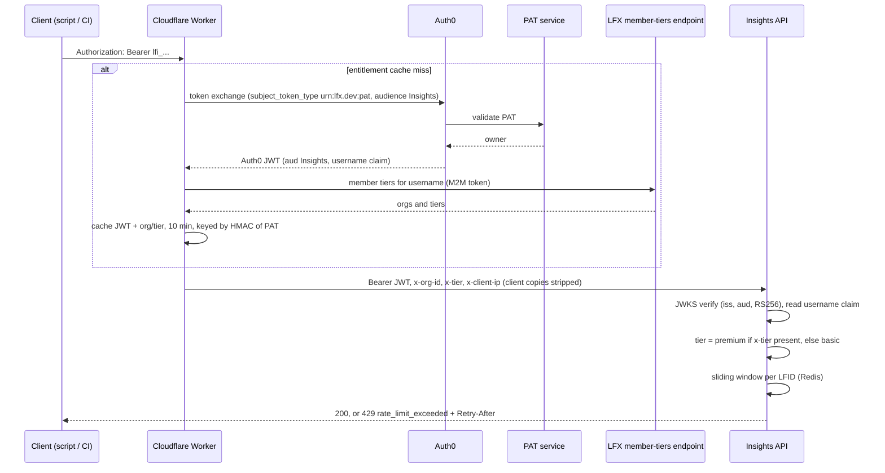
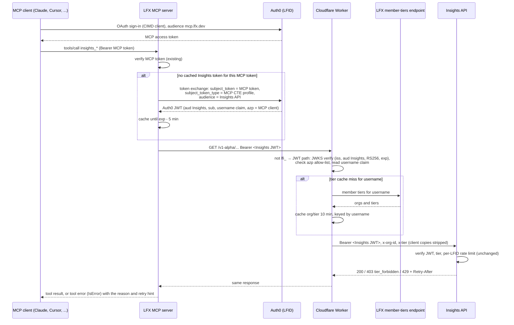

# Insights Public API in the LFX MCP: authentication and rate limiting

**Status**: proposal, for review
**Date**: 2026-10-28
**Author**: Joana Maia
**Related**: [ADR-0006](../../api/docs/arch/adr/0006-pat-token-exchange-for-api-credentials.md), [ADR-0010](../../api/docs/arch/adr/0010-billing-bundled-with-lfx-membership.md), [ADR-0015](../../api/docs/arch/adr/0015-api-keys-issued-by-lfx-self-serve.md), [ADR-0023](../../api/docs/arch/adr/0023-basic-and-premium-tiers.md), [linuxfoundation/lfx-mcp](https://github.com/linuxfoundation/lfx-mcp) (`ARCHITECTURE.md`)

## 1. Summary

The LFX MCP server (`mcp.lfx.dev`) will expose Insights Public API endpoints as MCP tools. The open question is authentication: how a request that starts in an MCP client reaches the Insights API so that the API can still identify the user, apply the user's tier (basic or premium) and enforce the user's rate limit.

**Recommendation:**

1. **Rate limits stay in the Insights API.** The MCP does not enforce Insights limits. It passes the authenticated user to Insights and turns the Insights `429` into a clear tool error.
2. **The MCP passes the user with an RFC 8693 token exchange**, the same pattern it already uses for the LFX Self Service APIs. It exchanges the user's MCP access token at Auth0 for a short-lived access token with the **Insights audience**, then calls `api.insights.linuxfoundation.org` with `Authorization: Bearer <JWT>`.
3. **The Cloudflare Worker gains a second credential path.** A token with the `lfi_` prefix still goes through the PAT exchange. Any other bearer token is treated as an Auth0 JWT: the Worker verifies it against the Auth0 JWKS, accepts it only from allow-listed clients (the MCP to start), then runs the same org and tier lookup and sets the same `x-org-id` and `x-tier` headers.
4. **The Insights API does not change.** It already verifies an Auth0 JWT with the Insights audience and keys the rate limit by the `http://lfx.dev/claims/username` claim. A user's MCP traffic and PAT traffic share one budget.

This is the path [ADR-0006](../../api/docs/arch/adr/0006-pat-token-exchange-for-api-credentials.md) anticipated in its "Forward compatibility: LFX MCP" section. This document turns it into a concrete design and records the decisions it still needs.

## 2. Current state

### 2.1 Insights Public API

Facts this design relies on (all from the current code):

| Component | Behavior                                                                                                                                           | Where                                            |
| --------- | -------------------------------------------------------------------------------------------------------------------------------------------------- | ------------------------------------------------ |
| Worker    | Accepts only `Bearer lfi_...`. Any other token gets `401` before reaching the API.                                                                 | `workers/api-gateway/src/pat.ts`, `src/index.ts` |
| Worker    | Resolves org and tier from `b2b_orgs/member-tiers/{username}` (or the LaunchDarkly admin list), caches the result with the JWT for 10 minutes.     | `src/tiers.ts`, `src/flags.ts`, `src/cache.ts`   |
| Worker    | Always strips client-supplied `x-tier`, `x-org-id`, `x-client-ip`. Reaches the API through a Workers VPC binding, so the origin is not public.     | `src/headers.ts`, `src/origin.ts`                |
| API       | Verifies the JWT with Auth0 JWKS: configured issuer, configured Insights audience, RS256. Rejects a token without the username claim.              | `api/src/auth.ts`                                |
| API       | Any `x-tier` value means premium, none means basic. Organization endpoints are premium only (`403 tier_forbidden`).                                | `api/src/tier.ts`                                |
| API       | 30 requests per second per LFID for both tiers for now. Returns `429` with `code: rate_limit_exceeded`, `Retry-After` and `X-RateLimit-*` headers. | `api/src/rate-limit.ts`, `api/src/lib/errors.ts` |

Note: the Insights-audience PAT prefix is `lfi_` (not `lfx_pat_`). This document uses `lfi_` throughout.

### 2.2 LFX MCP server

| Topic                          | Today                                                                                                                                                                                                                                                                                                                                                                         |
| ------------------------------ | ----------------------------------------------------------------------------------------------------------------------------------------------------------------------------------------------------------------------------------------------------------------------------------------------------------------------------------------------------------------------------- |
| Stack                          | Go, official MCP Go SDK, Streamable HTTP (stateless, new server per request) at `https://mcp.lfx.dev/mcp`, plus stdio for local use. Kubernetes, stateless pods with per-pod in-memory caches.                                                                                                                                                                                |
| Inbound auth                   | OAuth bearer tokens from Auth0 (LFID, `https://sso.linuxfoundation.org/`). Audience is the MCP public URL. Protected resource metadata (RFC 9728) is published. Clients register through CIMD (no DCR), with static Auth0 clients for MCP clients that lack CIMD. Scopes: `read:all`, `manage:all`. M2M callers (client credentials) and static API keys are also accepted.   |
| Calls to LFX Self Service APIs | RFC 8693 token exchange at Auth0: the user's MCP token is the `subject_token`, `subject_token_type` is the MCP's Custom Token Exchange profile, `audience` is the LFX API. The MCP authenticates as its own Auth0 client (private key JWT). The exchanged token is cached per inbound token until 5 minutes before expiry. The MCP never forwards the user's MCP token as is. |
| Calls to Lens / semantic layer | Shared MCP M2M token (client credentials). The user is not in the token. `query_lfx_lens` sends the Auth0 `sub` as a form field.                                                                                                                                                                                                                                              |
| Rate limits, 429, retries      | None. A `429` from upstream surfaces as a generic tool error. `Retry-After` is not read.                                                                                                                                                                                                                                                                                      |
| Insights                       | No Insights Public API client, configuration or audience yet.                                                                                                                                                                                                                                                                                                                 |

## 3. Goals and non-goals

**Goals**

- An MCP user's Insights calls are limited and tiered exactly as if the same user called the API with a PAT.
- One source of truth for limits, tiers and endpoint gating: the Insights API.
- No new credential type for users. Signing in to the MCP is enough. Users do not paste an `lfi_` PAT into the MCP.
- No change to the existing PAT path.

**Non-goals**

- Changing the tier model or the limit values (ADR-0023).
- Access for MCP M2M callers and static API keys, which carry no user (see section 8).
- Third-party (partner-built) MCP servers calling Insights. CIMD profiles for partners remain a later option (ADR-0006, alternative 4).

## 4. Rate limits: the MCP passes the user, the Insights API enforces

The Insights API enforces a per-user, per-tier limit, and MCP traffic must be subject to it. The MCP calls Insights with a credential that identifies the end user. The Worker and the API treat that request like any other user request. The MCP does not implement any rate limiting or tier logic; it only turns the API's `429` (and other errors) into tool errors (section 7).

- One policy, one implementation, already in production.
- The user's budget is shared between PAT and MCP traffic, as it should be: the limit is per LFID.
- Endpoint gating (`403 tier_forbidden` on organization endpoints) works with no MCP code.
- Per-user attribution in Insights traces and logs keeps working.
- Cost: the MCP needs a user-bound credential for the Insights audience, and the Worker must accept it. Section 5 covers this.

## 5. How the MCP passes the authenticated user

The MCP needs a credential that the Insights API can trust as "this request is from user X". The candidates:

|                         | 1: forward the MCP token as is                                                                                                          | 2: token exchange to the Insights audience (recommended)              | 3: MCP M2M token plus a user header                                                                          | 4: user stores an `lfi_` PAT in the MCP                                                      |
| ----------------------- | --------------------------------------------------------------------------------------------------------------------------------------- | --------------------------------------------------------------------- | ------------------------------------------------------------------------------------------------------------ | -------------------------------------------------------------------------------------------- |
| What reaches Insights   | The user's MCP token (audience `mcp.lfx.dev`)                                                                                           | An Auth0 JWT for the user with the Insights audience                  | The MCP's own token, plus `x-on-behalf-of: <LFID>`                                                           | The user's PAT                                                                               |
| User identity proven by | Auth0 signature                                                                                                                         | Auth0 signature                                                       | The MCP's word                                                                                               | PAT service                                                                                  |
| Insights changes        | Worker and API accept a second audience                                                                                                 | Worker accepts JWTs (JWKS verify). API unchanged.                     | Worker and API trust a header from one client                                                                | None                                                                                         |
| MCP changes             | Small                                                                                                                                   | Second exchange audience, error mapping                               | Small                                                                                                        | Per-user secret storage, new UX                                                              |
| Problems                | Token passthrough, which the MCP authorization spec forbids. Insights would accept tokens minted for another service (confused deputy). | Needs Auth0 configuration (CTE profile allows the Insights audience). | Anyone holding the MCP's client credentials can act as any user. Unsigned identity on a premium-gating path. | Users manage a second secret. Defeats the OAuth sign-in. The MCP becomes a credential store. |

**Decision: option 2.** It is the pattern the MCP already uses for the LFX Self Service APIs (`internal/lfxv2/token_exchange.go`), the user identity is signed by Auth0, the token is scoped to Insights only, and the Insights API keeps verifying a single audience.

## 6. Proposed design

### 6.1 Flow

All routes are served under `/v1-alpha` today; the `/v1` prefix is registered but has no routes yet. The MCP tools call `/v1-alpha` and move to `/v1` when it ships, following the `Deprecation` and `Sunset` headers ([ADR-0021](../../api/docs/arch/adr/0021-rfc-deprecation-sunset-header-formats.md)).

### 6.2 Why the Worker verifies the JWT and not only the API

The API would reject a forged token anyway, so verifying at the Worker can look redundant. It is needed because the Worker does work and sets trusted headers before the API sees the request:

- Without verification, any string that looks like a JWT would trigger a member-tiers lookup with the Worker's M2M token. That is a cheap way to load that endpoint.
- The Worker reads the username from the token to choose the tier. Doing that from an unverified payload means tier decisions rest on attacker-controlled input, even if the API rejects the request later.
- The `azp` allow-list can only be enforced where the token is verified.

## 7. Error contract between the API and the MCP

The MCP returns errors as tool results with `IsError: true`, never as JSON-RPC errors (its existing convention). The agent should get enough to decide what to do next.

| Insights response         | Meaning                                                                    | MCP behavior                                                                                                                                                                                                                                                      |
| ------------------------- | -------------------------------------------------------------------------- | ----------------------------------------------------------------------------------------------------------------------------------------------------------------------------------------------------------------------------------------------------------------- |
| `401 unauthorized`        | Exchanged token rejected (expired, wrong audience, missing username claim) | Drop the cached Insights token, exchange again once, retry once. If it fails again, return a tool error: authentication with Insights failed.                                                                                                                     |
| `403 tier_forbidden`      | Basic-tier user called a premium-only endpoint (organization endpoints)    | Tool error: this data needs an LFX membership (premium tier), with a link to the Insights API tier docs. Do not retry.                                                                                                                                            |
| `403` / `404` (other)     | Not found or not allowed                                                   | Existing shared access-denied message.                                                                                                                                                                                                                            |
| `429 rate_limit_exceeded` | The user's per-LFID limit is exhausted                                     | Tool error that states the limit was hit and the `Retry-After` value in seconds, and tells the agent to wait before calling again and to avoid parallel calls. No retry loop inside the MCP: pods are stateless and a sleeping request ties up a pod for nothing. |
| `5xx` / `503`             | Insights or an upstream (Auth0 JWKS, member-tiers) is unavailable          | Tool error: Insights is temporarily unavailable. No retry.                                                                                                                                                                                                        |

The Insights API keeps owning the limit numbers and the headers. The MCP does not parse `X-RateLimit-*` to throttle itself. It may pass them through in the tool result `_meta` if that turns out useful for clients.

Rate-limit budget: agents often issue several tool calls in parallel. With 30 requests per second per user this is unlikely to be hit by one user's MCP session, but the limit is shared with the same user's PAT scripts. This is intended (one budget per user) and should be stated in the user-facing docs.

## 8. Callers without a user

The MCP also accepts M2M tokens (client credentials) and static API keys. Neither has a user, and the Insights API requires the username claim, so these callers cannot use Insights tools under this design. Proposal for v1: do not register Insights tools for them.

If a real need appears (for example an internal automation), the options are:

- the automation uses its own `lfi_` PAT against the API directly, or
- the Insights API learns a service-principal concept (its own key and limit). That is a separate decision and needs its own ADR.

The stdio mode uses a static token from `lfx auth token`. If that token has the MCP audience, the same exchange works. If not, Insights tools stay off in stdio mode until it does.

## 9. Security considerations

- **No token passthrough.** The MCP never forwards the user's MCP token to Insights, and Insights only accepts tokens minted for its own audience.
- **Narrow audience.** Only two Auth0 clients can obtain Insights-audience tokens: the Worker (PAT exchange) and the MCP (user exchange). The Worker allow-list on `azp` enforces this even if Auth0 configuration widens by mistake.
- **Trusted headers stay Worker-only.** The origin is reachable only through the Workers VPC binding, and the Worker strips client copies of `x-tier`, `x-org-id`, `x-client-ip` on both paths. This matters more now that `x-tier` gates the organization endpoints (ADR-0023).
- **Revocation.** MCP access is checked only at Auth0 sign-in, not per request (lfx-mcp `ARCHITECTURE.md`, "Sign-in entitlement"). Revoking it blocks the next sign-in, but an MCP token issued before the revocation can keep being exchanged for Insights tokens until it expires. Unless the token exchange rechecks MCP access, the window is the remaining lifetime of the user's MCP token plus the lifetime of the last Insights token issued. If the exchange action rechecks access (open question 9), the window shrinks to one Insights token lifetime, comparable to the 10-minute window on the PAT path. Either way, the Insights token lifetime should stay short. A lapsed membership drops the user to basic within the 10-minute tier cache window, as on the PAT path.
- **Scopes.** The exchanged Insights token does not need `manage:all`. Insights is read-only. If the CTE action copies scopes, it should drop write scopes for the Insights audience.
- **Abuse of the member-tiers endpoint.** Prevented by verifying before lookup and caching tiers per LFID.

## 10. Rollout

1. **Auth0**: Insights audience allowed for the MCP CTE profile, username claim on the exchanged token, token lifetime set. Test in the dev tenant first.
2. **Worker**: JWT path, off by default until the MCP client is on the allow-list.
3. **MCP**: Insights toolset, off by default, using the token exchange and the error contract in section 7.
4. **End to end in dev**, then allow the MCP client in the production Worker and turn the toolset on.
5. **Docs**: Insights API docs (MCP access shares the per-user limit) and the MCP README (Insights tools, tier gating).

## 11. Open questions

| #   | Question                                                                                                                                                                      | Owner                  |
| --- | ----------------------------------------------------------------------------------------------------------------------------------------------------------------------------- | ---------------------- |
| 1   | Can the existing MCP Custom Token Exchange profile target a second audience, or does Insights need its own profile?                                                           | SSO / Auth0 admin      |
| 2   | Does Auth0 set the username claim on MCP-exchanged tokens for the Insights audience?                                                                                          | SSO / Auth0 admin      |
| 3   | Exchanged token lifetime for the Insights audience.                                                                                                                           | SSO, Insights          |
| 4   | Which claim identifies the calling client on exchanged tokens: `azp` or `client_id`? The Worker allow-list keys on it.                                                        | SSO                    |
| 5   | Which Insights endpoints become MCP tools in v1, and do Collections (user-owned, ADR-0007) belong in the first set?                                                           | Product, Insights, MCP |
| 6   | MCP tools are staff-only for Lens today. Are Insights tools open to every MCP user with `read:all`, with tier gating left to the API? (This proposal assumes yes.)            | Product, MCP           |
| 7   | Should the PAT path and the JWT path share one tier cache keyed by LFID? (Proposed yes; changes the PAT cache layout.)                                                        | Insights               |
| 8   | Do the MCP tool descriptions mention "Insights"? Several MCP tests currently ban the word in tool text.                                                                       | MCP                    |
| 9   | Can the Custom Token Exchange action recheck the user's MCP access at exchange time, within the Auth0 action time budget? If not, the revocation window in section 9 applies. | SSO / Auth0 admin      |

## 12. Follow-ups

- Record the outcome as an ADR in `api/docs/arch/adr/` (amending ADR-0006's forward-compatibility section) once Auth0 confirms questions 1, 2 and 4.
- Matching entry in `lfx-mcp/ARCHITECTURE.md` as a fourth upstream pattern, or as a second audience under the existing token-exchange pattern.
